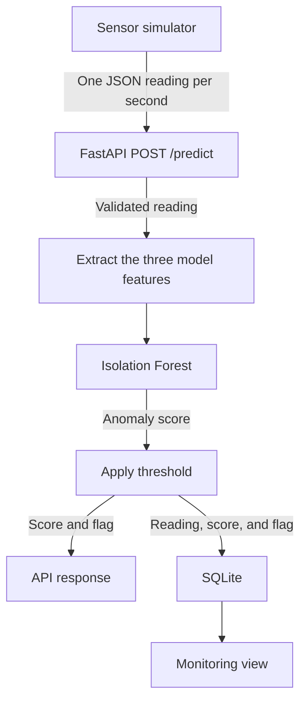

# Phase 1 — System architecture

This project will detect unusual temperature, humidity, and sound readings
in a simulated wind-turbine component production line.

## Data flow



## API contract

The simulator sends a reading to `POST /predict`.

```json
{
  "sensor_id": "line-01",
  "timestamp": "2026-11-16T20:00:00Z",
  "temperature_c": 26.4,
  "humidity_pct": 48.2,
  "sound_db": 67.5
}
```

The API checks that all fields are present, the timestamp includes a
timezone, the measurements are finite numbers, and humidity is between
0 and 100 percent. A request that fails validation returns HTTP 422
with details about the invalid fields.

Example response with illustrative values:

```json
{
  "sensor_id": "line-01",
  "timestamp": "2026-11-16T20:00:00Z",
  "anomaly_score": 0.31,
  "threshold": 0.65,
  "is_anomaly": false
}
```


Higher scores indicate more unusual readings. The API sets `is_anomaly`
to `true` when the score meets or exceeds the threshold. The threshold
will be chosen during model development and evaluated on held-out data.

## Design decisions

- Train Isolation Forest offline on simulated normal readings. Use injected
  anomaly labels in evaluation to measure precision, recall, and F1.
- Use temperature, humidity, and sound as model inputs in a fixed order.
  Keep the sensor ID and timestamp for tracing predictions back to readings.
- Load the trained model when FastAPI starts. Store inputs, scores, and
  decisions in SQLite so the monitoring view can show recent flagged
  readings and how scores change over time.
- Track request count, latency, and errors to see whether the API is
  keeping up with the simulator.
- Start with one reading per request. Add batch support during API packaging.

## Limitations

Evaluation on simulated data measures how well the model detects the
anomalies we inject. Performance on a real production line would need
to be measured with actual sensor data.

## Training and model handoff

1. The simulator generates normal readings for training and separate
   labeled datasets for validation and testing.
2. The training script fits Isolation Forest on normal readings and
   chooses an anomaly threshold using the validation set.
3. The evaluation script reports precision, recall, F1, and a confusion
   matrix on the held-out test set.
4. The training script saves the fitted model, feature order, and
   threshold in a joblib artifact. FastAPI loads it at startup.